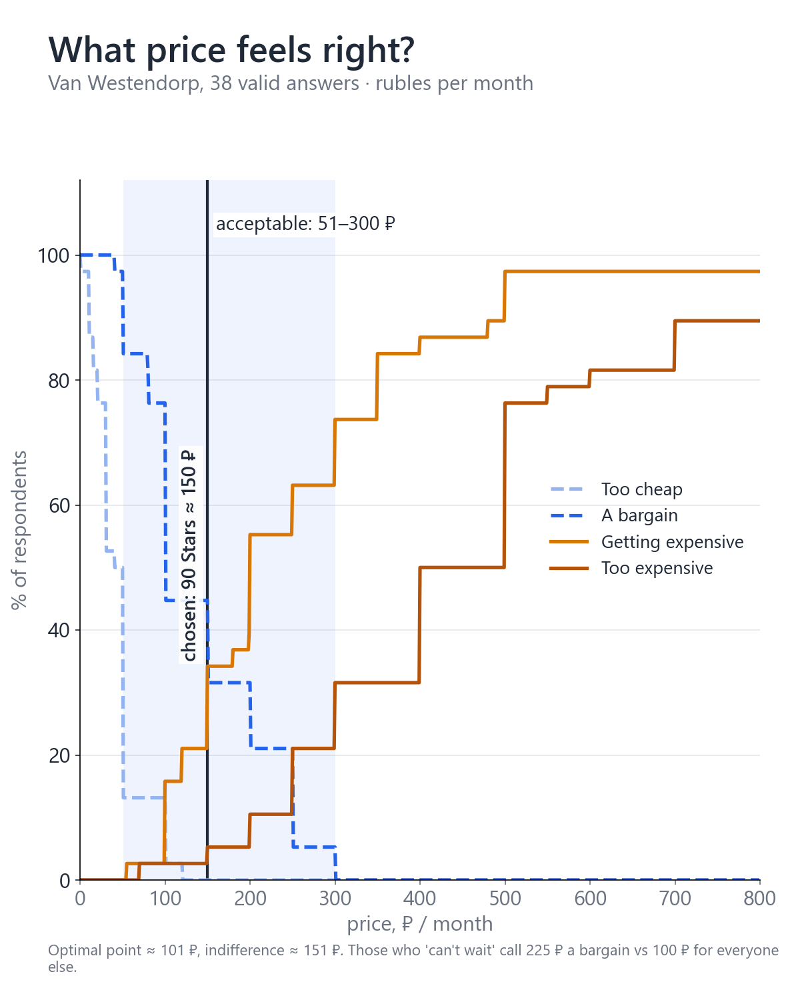
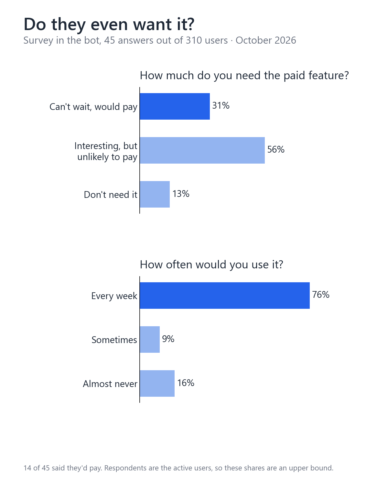
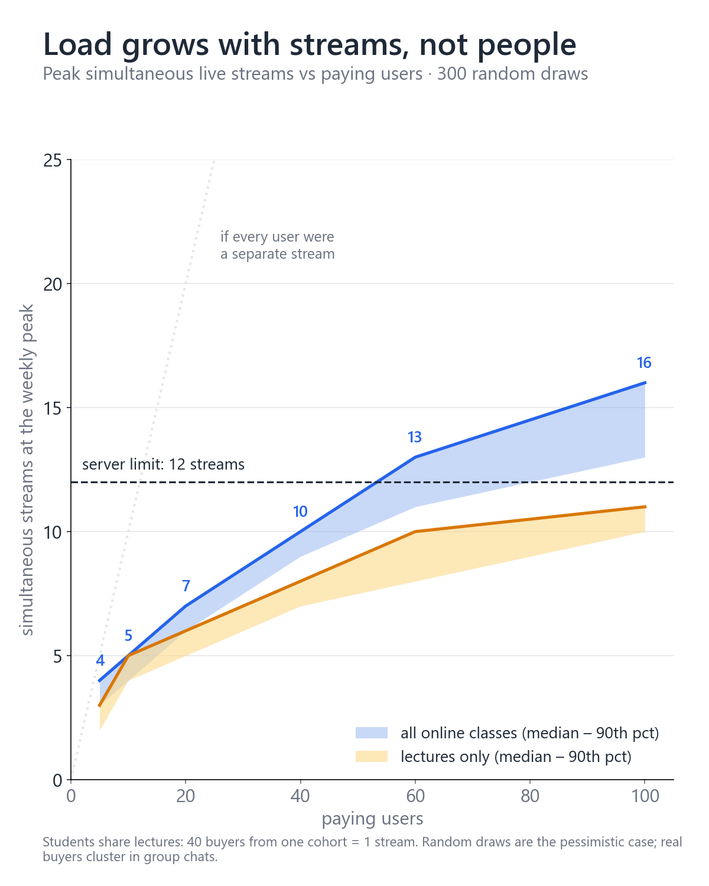
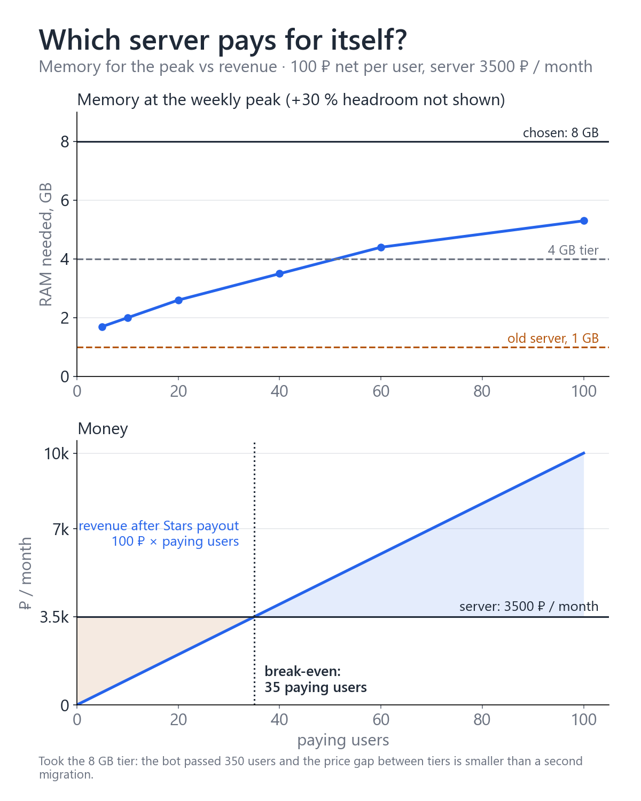
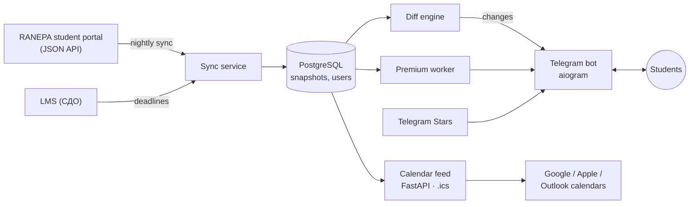

# Ikanam Schedule — a Telegram bot for RANEPA students

**Try it:** [@Ikanam_schedule_bot](https://t.me/Ikanam_schedule_bot) · **News channel:** [@ikanam_schedule](https://t.me/ikanam_schedule)

A Telegram bot that pulls a student's personal timetable from the RANEPA student portal and delivers it
in chat, as an `.ics` file and as a **live calendar subscription** (Google, Apple, Android, Outlook).
On top of the free core there is a paid premium feature, priced with a student survey and sized
to the server it runs on.

> This repository is a project overview. The source code is private.
> Unofficial project, not affiliated with RANEPA.

## At a glance

| | |
|---|---|
| Users | **387** students, 376 with the portal connected |
| Growth | 0 → 387 in two months (6 Sep – 5 Nov 2026); +21 in the last week |
| Paying users | **12** in the first two weeks after the premium launch, 1,260 ⭐ (≈ 2,100 ₽) |
| Infrastructure | one VPS (6 vCPU / 8 GB), Docker Compose, PostgreSQL; capacity ~12–14 premium lessons at once |
| Timeline | first commit 4 Sep 2026 · first users 6 Sep · premium opened 21 Oct |

Figures from the production database, 5 Nov 2026.

## The problem

RANEPA has an official timetable bot, but only in the MAX messenger, and neither it nor the portal
puts lessons into the phone's calendar. Students check the portal by hand, miss room changes
and cancellations, and can't see lessons next to the rest of their week.

## What the bot does

- **Timetable in Telegram** — today / tomorrow / week, with lesson type, room, building and lecturer
- **Calendar subscription** — one link, the phone's calendar keeps itself up to date
- **Change alerts** — moved lessons, room changes and cancellations arrive as a push
- **Morning digest** at a time the student picks
- **Deadlines from the LMS (СДО)** — assignment due dates in a separate calendar
- **Group transfers** handled automatically: the bot notices when the portal moves a student to another group
- **Premium feature** — resource-heavy, runs per lesson on the server; paid with Telegram Stars

## My role

I'm an analyst who took this from a question to a product in production. My part:

- **Research** — user survey (45 answers out of 310 users), price range with the Van Westendorp method
- **Pricing and unit economics** — 90 ⭐ ≈ 150 ₽/month; break-even at 35 paying users
- **Capacity planning** — modelled peak load from real timetables (simultaneous lessons, not user count)
  and picked the server from that model
- **Incidents** — diagnosed outages caused by portal maintenance and a headless-browser leak,
  wrote the runbook
- **Security** — data-minimisation decisions, an internal security audit (Nov 2026)
- **Product decisions** — what to build next, from user messages and usage data

The code was written with an AI coding assistant (Claude Code) under my direction:
I set the requirements, reviewed the changes and ran production.

## How it was decided

### Pricing

### Demand

### Server sizing

Load depends on how many lessons run **at the same time**, not on how many people use the bot.
I took real timetables, drew 300 random sets of paying users and measured the weekly peak.

## Architecture

- **API, not scraping** — the portal is a Nuxt app over a JSON API; the bot uses the API, which changes far less often than the markup
- **Diff on snapshots** — every sync is compared with the previous one; only real changes become alerts
- **Calendar updates done right** — stable `UID` and `SEQUENCE` so calendars update events instead of duplicating them
- **Secrets** — the portal password is used once and never stored; refresh tokens are encrypted (Fernet), `/logout` deletes everything

**Stack:** Python 3 · aiogram 3 · FastAPI · SQLAlchemy 2 (async) · PostgreSQL · Alembic · APScheduler ·
Playwright · Docker Compose · Caddy · Telegram Stars

## Contact

Oleg Popov — GitHub [@Legpopov](https://github.com/Legpopov) · the bot: [@Ikanam_schedule_bot](https://t.me/Ikanam_schedule_bot)
